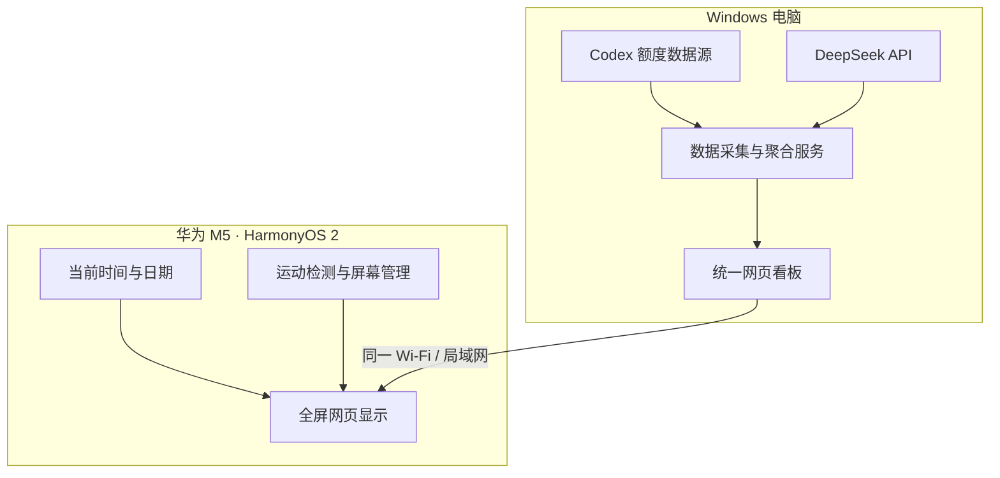

# 华为 M5 AI 用量桌面看板：前期调研报告

> **调研范围：仅分析，不实施。** 不下载仓库、不安装 APK、不启动项目、不修改平板或电脑、不访问用户账户。  
> 设备：HUAWEI M5，型号 CMR-W09，HarmonyOS 2.0.0.230。  
> 数据端：Windows 电脑。  
> 网络：平板和电脑通常连接同一 Wi-Fi。  
> 目标：平板显示 Codex 账户额度与重置时间、DeepSeek API 用量、当前时间；尽可能实现人来亮屏、人走息屏。

## 1. 执行摘要

初步建议采用“Windows 负责数据采集和聚合，华为 M5 负责网页展示”的架构，而不是在平板上安装多个统计工具。

优先研究的候选组合：

- **OpenUsage**：作为 DeepSeek API 余额与多服务用量聚合的候选。
- **WallMode**：作为平板全屏网页展示、时钟和运动唤醒的候选。
- **Codex Usage Dashboard**：作为 Codex 账户额度与重置时间的数据获取方式参考。
- **NiKiosk**：作为需要更强屏幕电源管理时的备选。

目前没有证据证明这些项目能在 HarmonyOS 2.0.0.230 上直接组合成功。仍需重点验证两件事：

1. Codex 五小时/每周额度和重置时间能否通过稳定、安全的方式提供给局域网看板。
2. CMR-W09 上的摄像头运动检测、后台运行和真正息屏/唤醒是否可行。

本报告只提供候选分析和后续调查建议，不代表项目已在设备上测试通过。

## 2. 需求与边界

### 2.1 目标功能

- 显示当前时间、日期。
- 显示 Codex 账户使用额度、重置时间。
- 显示 DeepSeek API 账户余额或其他可获取的 API 用量数据。
- 平板全屏显示一张统一看板。
- 尽可能实现检测到人靠近时亮屏、无人时息屏。
- Windows 电脑作为数据端，平板通过同一 Wi-Fi 访问。
- 优先复用开源项目，尽量减少自研内容。

### 2.2 本轮明确不做的事

- 不下载、克隆或运行 GitHub 仓库。
- 不安装或侧载 APK。
- 不更改 HarmonyOS 设置。
- 不访问 Codex 或 DeepSeek 账户。
- 不读取或复制任何账户令牌、Cookie 或 API Key。
- 不把候选项目的 README 描述视为已经验证的实际能力。

## 3. 候选项目

### 3.1 WallMode：平板展示端首选候选

项目地址：<https://github.com/rvbcrs/WallMode>

用途：Android 平板网页仪表盘、全屏展示、时钟屏保、摄像头运动唤醒等。

初步优点：

- 可以将局域网网页作为显示内容。
- 具备时钟/屏保类使用场景。
- 项目说明提及摄像头运动检测唤醒。
- 可把平板定位为单纯展示终端，不必在平板上运行数据采集服务。

待验证：

- 项目要求的 Android 版本和 Android System WebView 是否与该设备的实际运行环境兼容。
- HarmonyOS 2.0.0.230 是否能正常运行该应用。
- 摄像头检测在屏保、调暗或息屏状态下是否持续工作。
- 软件黑屏、调暗屏幕与真正关闭屏幕的差别。
- 权限声明、网络请求、日志、更新机制和许可证义务。

初步判断：**优先调查**，但未验证在 CMR-W09 上可用。

### 3.2 NiKiosk：屏幕管理备选

项目地址：<https://github.com/MatTech07/NiKiosk>

用途：Android kiosk/全屏网页、运动检测、待机、设备管理和远程控制等。

初步优点：

- 更强调设备管理和屏幕控制。
- 可用于调查真正息屏及唤醒流程。
- 可作为 WallMode 无法满足电源管理需求时的备选。

待验证：

- 设备管理员权限在 HarmonyOS 2 上的可用性和限制。
- 摄像头或其他传感器服务在息屏期间是否保持运行。
- 屏幕关闭后能否由运动事件唤醒。
- Web 管理面板的认证、局域网访问控制及远程管理风险。
- 仓库是否提供明确的标准开源许可证，以及修改/再分发条件。

初步判断：**作为屏幕电源管理的重点备选**，不能仅凭 README 认定已兼容。

### 3.3 OpenUsage：DeepSeek API 数据端首选候选

项目地址：<https://github.com/ellite/openusage>

用途：自托管 AI 服务用量仪表盘，提供多服务聚合及 Web 界面。

初步优点：

- 适合在 Windows 电脑上作为数据端研究。
- DeepSeek 集成可用于查询账户余额。
- 采用服务端和网页前端分离的架构，适合平板通过局域网访问。
- 服务凭据留在服务端的设计，比把 API Key 写入平板前端更合理。

待验证：

- 当前版本对 DeepSeek 的实际支持字段、认证方式及刷新行为。
- DeepSeek API 余额是否足以满足目标，是否还需要独立的用量统计。
- Codex 集成具体覆盖哪些账户字段和认证方式。
- API Key、Cookie、会话数据、日志和数据库的保护方式。
- 局域网接口是否需要认证，注册功能能否关闭。
- Docker 镜像、依赖和源码版本之间的对应关系。

初步判断：**优先研究 DeepSeek API 余额与多服务聚合能力**。不要假定它能提供所有 DeepSeek 聊天或 Token 明细。

### 3.4 Codex Usage Dashboard：Codex 额度数据参考

项目地址：<https://github.com/zhang-mengjia/codex-usage-dashboard>

用途：Codex 账户额度、使用窗口和重置时间的桌面仪表盘。

初步优点：

- 项目说明涉及五小时和每周额度、重置时间等与需求高度相关的数据。
- 可作为识别 Codex 额度字段和数据获取方式的参考。

待验证：

- 数据来源是否依赖本机 Codex/ChatGPT 的 app-server 或特定协议。
- 是否存在稳定、受支持的只读数据接口。
- 是否能安全地把必要字段输出到局域网网页。
- 认证令牌的存储、读取、传输与日志处理方式。
- 官方应用更新后，数据获取方式是否可能失效。

重要边界：不要为了显示额度而直接复制、导出或暴露 OAuth 令牌。若没有可靠的只读数据途径，应重新评估数据方案。

初步判断：**优先研究其额度数据来源，但不能直接视为平板网页服务。**

### 3.5 Codex Usage Monitor：架构参考

项目地址：<https://github.com/en4ble1337/codex-usage-monitor>

用途：读取 Codex CLI 状态信息、生成 JSON 数据，并通过网页展示。

初步优点：

- 展示了“采集程序”和“网页服务”分离的思路。
- 可参考如何把电脑端数据转成网页容易读取的格式。

局限与待验证：

- 文档偏向 Linux/WSL 使用方式，Windows 原生部署可能不够直接。
- 如果解析终端文本，CLI 输出变化可能导致解析失效。
- 需要审查脚本执行、数据同步选项和潜在敏感信息暴露。

初步判断：**更适合作为架构参考，不作为当前直接部署首选。**

## 4. 候选对比

| 项目 | 主要职责 | 与需求的匹配度 | 主要未知项 |
|---|---|---|---|
| WallMode | 平板全屏网页、时钟、运动唤醒 | 高 | HarmonyOS 兼容、真实息屏 |
| NiKiosk | kiosk 展示、设备管理、屏幕控制 | 中高 | 管理权限、息屏后唤醒、许可证 |
| OpenUsage | AI 服务用量聚合、DeepSeek 余额 | 高 | 实际字段、认证与安全配置 |
| Codex Usage Dashboard | Codex 额度与重置时间 | 高（数据参考） | 数据接口、认证边界、外部输出 |
| Codex Usage Monitor | CLI 数据采集与网页展示 | 中（架构参考） | Windows 部署、解析稳定性 |

以上匹配度是基于公开项目说明的初步判断，不是设备测试结果，也不是完整源码安全审计结论。

## 5. HarmonyOS 2.0.0.230 兼容性风险

HarmonyOS 2.0.0.230 的版本号本身不足以证明某个 APK 一定能运行或所有 Android API 都能正常工作。

需要区分以下问题：

1. **APK 安装与启动**：应用能否安装并正常打开。
2. **WebView**：应用使用的网页组件是否可用、版本是否满足要求。
3. **摄像头权限**：前置摄像头是否可授权并稳定工作。
4. **后台运行**：屏幕进入屏保、调暗或息屏后，传感器检测是否还在工作。
5. **屏幕电源控制**：应用是否只能显示黑色页面，还是能真正关闭屏幕。
6. **唤醒路径**：真正息屏后，运动检测是否能再次唤醒屏幕。
7. **系统策略**：电池优化、后台限制或厂商定制行为是否会中断服务。

> 下表为本章最初（实施前）的判断。**阶段 A/B 已在 CMR-W09 上完成实测**，实测结论见第 11 节。

| 能力 | 实施前结论 | 实测结论（见第 11 节） |
|---|---|---|
| 在 HarmonyOS 2 上运行 WallMode | 未验证 | **已验证**：可安装、可全屏运行 |
| 在 HarmonyOS 2 上运行 NiKiosk | 未验证 | 仍未验证（未实测，暂不需要） |
| 使用前置摄像头运动检测 | 未验证 | **已验证**：WallMode 独占并激活前置相机 |
| 真正关闭屏幕 | 未验证 | **未实现**：WallMode 仅提供调暗/屏保 |
| 息屏后检测运动并唤醒 | 未验证 | **部分验证**：调暗态下人靠近可恢复正常亮度 |
| 通过局域网访问 Windows 网页 | 架构上可行，设备网络策略仍需确认 | **已验证**：直连 `http://<看板服务器IP>:8787/` 正常渲染 |

建议后续优先查阅两个项目的 AndroidManifest、Gradle 配置、屏幕电源管理代码、摄像头服务生命周期，以及权限请求实现，再决定是否值得进行设备实测。

## 6. 建议目标架构



说明：

- Windows 端负责读取可安全获取的额度/余额信息并提供网页。
- 平板只展示数据，不保存 DeepSeek API Key 或 Codex 账户令牌。
- 时钟优先使用平板本地时间显示。
- 屏幕管理由经过兼容性验证的平板端应用承担。
- Codex 额度数据源是当前待确认模块，不能假定已有稳定、受支持的外部接口。

## 7. 安全与许可证审查清单

后续审查源码时，应逐项记录证据，而不是仅凭项目介绍下结论。

### 7.1 源码与构建

- [ ] 仓库许可证是否明确。
- [ ] 最近提交、发布版本与维护状态。
- [ ] 发布的 APK/容器镜像是否能对应到具体源码版本。
- [ ] 是否存在混淆、下载并执行远程脚本或未经说明的二进制依赖。
- [ ] 依赖是否固定版本，是否存在已知风险。

### 7.2 权限与网络

- [ ] AndroidManifest 中的摄像头、麦克风、网络、设备管理员等权限。
- [ ] 权限是否与启用功能相匹配。
- [ ] 是否有未说明的外部网络请求或遥测。
- [ ] 局域网管理接口是否有身份验证。
- [ ] 默认端口、绑定地址及是否可能意外暴露到公网。

### 7.3 凭据与个人数据

- [ ] DeepSeek API Key 是否仅存放于服务端。
- [ ] Codex OAuth 令牌或 Cookie 是否被读取、复制或传输。
- [ ] 日志是否可能记录密钥、令牌或完整请求头。
- [ ] 数据库、备份文件和导出文件是否含敏感信息。
- [ ] 错误提示和调试接口是否泄露配置。

### 7.4 屏幕与传感器

- [ ] 摄像头帧是否仅用于本地运动检测。
- [ ] 是否保存或上传摄像头图像。
- [ ] 屏幕关闭操作调用了什么 Android API。
- [ ] 设备管理员权限的启用、撤销和卸载流程。
- [ ] 息屏期间后台服务的生命周期和唤醒机制。

### 7.5 许可证提醒

WallMode 和 OpenUsage 的公开资料标示 GPL-3.0。若未来修改、发布衍生版本或分发构建产物，需要进一步评估许可证义务。

对于许可证信息尚未核实的项目，不应仅因其免费或源码可见，就假定可以任意修改、再分发或商用。

## 8. 当前结论与后续优先级

### 优先级 1：查明 Codex 额度数据来源

首先研究 Codex Usage Dashboard 的相关源文件和依赖，确认五小时额度、每周额度及重置时间的来源，以及是否存在安全、稳定的只读数据途径。

这是目前数据链路中最关键的不确定性。

### 优先级 2：确认 OpenUsage 的 DeepSeek 数据能力

确认当前版本实际能提供哪些 DeepSeek 字段、如何认证、如何刷新，以及局域网访问的安全边界。

### 优先级 3：审查 WallMode 与 NiKiosk 的关键代码

重点看 Android 版本要求、WebView、摄像头服务生命周期、屏幕电源 API、设备管理员权限和唤醒机制。

### 优先级 4：形成实施前决策

只有在数据来源、设备兼容性、安全边界和许可证都得到合理评估后，才决定：

- 直接组合现成项目；
- 复用现成项目并增加轻量数据适配层；
- 或者放弃不兼容的平板端方案，改用普通浏览器展示。

## 9. 参考链接

以下是本轮调研使用的候选项目及官方仓库链接。链接可用于后续继续核查 README、源码、许可证、发布记录和依赖配置。

- WallMode：<https://github.com/rvbcrs/WallMode>
- NiKiosk：<https://github.com/MatTech07/NiKiosk>
- OpenUsage：<https://github.com/ellite/openusage>
- Codex Usage Dashboard：<https://github.com/zhang-mengjia/codex-usage-dashboard>
- Codex Usage Monitor：<https://github.com/en4ble1337/codex-usage-monitor>

> **最终判断：** “Windows 采集数据 + 局域网网页看板 + 华为 M5 全屏展示”是合理的候选架构。现阶段不应宣称已经验证兼容。下一步最值得投入的是确认 Codex 额度的安全数据来源，以及 HarmonyOS 2 对摄像头运动检测和真正息屏/唤醒的支持情况。

## 10. 优先级调研执行结果（本轮）

> 本轮按第 8 节的优先级逐项执行了公开资料与源码核查，结论基于各项目的 README、源码文件与官方文档。**未在 CMR-W09 上做设备实测**，涉及 HarmonyOS 兼容性的结论仍标注为“未验证”。

### 10.1 优先级 1：Codex 额度数据来源（已查明，可行）

结论：Codex 的 5 小时/周额度与重置时间可以**免令牌、只读**获取，无需复制或导出 OAuth 令牌/Cookie。候选路径按可靠性排序：

1. **`codex app-server` 的 JSON-RPC 方法 `account/rateLimits/read`（首选）**
   - 启动 `codex app-server`（stdio 上跑 JSON-RPC，省略 `"jsonrpc":"2.0"` 头），先发 `initialize` 握手，再调用该方法。
   - 返回 `rateLimits.primary`（5 小时窗口）与 `rateLimits.secondary`（周窗口），各含 `usedPercent` 与 `resetsAt`。
   - app-server 协议本身是官方文档化的（<https://developers.openai.com/codex/app-server/>，开源实现 `openai/codex/codex-rs/app-server`），但**该方法未列入官方 API 概览清单**，属未文档化接口，需版本容错与健康检查。
   - 复用 Codex 自身已认证会话，不接触任何令牌文件。
2. **本地会话 rollout JSONL**
   - 读取 `~/.codex/sessions/YYYY/MM/DD/rollout-*.jsonl`，取最新 `token_count` 事件中的 rate-limit 字段：`primary`（约 300 分钟=5 小时）、`secondary`（10080 分钟=周），各含 `usedPercent`/`resetsAt`。纯文件读取，无认证。
3. **`codex /status` 终端抓取（回退）**
   - `codex /status` 在非交互模式无输出，需开 PTY 并发送 `/status`，再解析 `5h limit: … % left · resets …`、`Weekly limit: …`。参考实现 `en4ble1337/codex-usage-monitor` 的 `local/monitor.sh`（MIT）。对输出格式变化脆弱。
4. **上游 HTTP 响应头**（如 `x-codex-primary-used-percent` / `x-codex-secondary-used-percent` / `-window-minutes` / `-reset-at`）——由 Codex 自身请求携带。

**引用更正：** 报告第 3.4/9 节引用的 `zhang-mengjia/codex-usage-dashboard` GitHub 仓库**返回 404**（疑似已失效/改名/私有），不可作为依据；npm 上存在同名包。建议改用 `en4ble1337/codex-usage-monitor`（真实存在，MIT）作为终端抓取参考。

**安全边界：** 方案 1–3 均不需要读取/复制 `~/.codex/auth.json` 或任何 OAuth 令牌；风险点是未文档化接口随 Codex 更新可能失效，需容错解析 + 失效告警。

**本机烟测结果（已验证）：** 在本机 Windows 上以 `codex-cli 0.150.1` 实际运行 `codex app-server`，发送 `initialize` 握手后调用 `account/rateLimits/read`，返回如下结构（已省略无关字段）：

```json
{"id":1,"result":{"rateLimits":{
  "limitId":"codex",
  "primary":{"usedPercent":0,"windowDurationMins":43200,"resetsAt":1794281376},
  "secondary":null,
  "credits":{"hasCredits":false,"unlimited":false,"balance":null},
  "planType":"free","rateLimitReachedType":null
},"rateLimitsByLimitId":{ "...": "..." },"rateLimitResetCredits":{"availableCount":0,"credits":[]}}}
```

要点：
1. 该方法**存在且可用、只读**，全程未读取/导出任何令牌——风险 1 的接口可用性已被实测确认。
2. **窗口集合由账户套餐决定**：当前本机会话 `planType:"free"`，只返回**一个 30 天窗口**（`windowDurationMins:43200`、`usedPercent:0`），`secondary` 为 `null`，**不含 5h/周窗口**；付费套餐才会给出 primary=300(5h) 与 secondary=10080(周)。
3. 采集端**不得硬编码 300/10080**，应按 `windowDurationMins` 解释窗口，兼容免费/其他套餐。
4. 进程会向 stderr 输出大量日志并自行连接 `chatgpt.com` 的 remote-control websocket；采集时**只解析 stdout 中按 `id` 匹配的 JSONL**，忽略 stderr。

**遗留问题：** “显示 5h/周额度”取决于实际使用的 Codex 账号——本机当前为免费套餐，需在目标（付费）账号环境中重取一次以确认 primary/secondary 出现在同一字段结构下。

### 10.2 优先级 2：OpenUsage 的 DeepSeek 数据能力（已确认）

项目：<https://github.com/ellite/openusage>（自托管，FastAPI + Astro 单容器，GPL-3.0）。

- **DeepSeek：仅“账户余额”**。实现为 `backend/fetchers/deepseek.py`：`GET https://api.deepseek.com/user/balance`，头部 `Authorization: Bearer <deepseek_api_key>`，返回原始 JSON（`is_available`、`balance_infos`）。
  → **不提供** token/聊天明细或每日用量统计；如需用量明细需另建方案。
- **Codex / ChatGPT：** 支持 plan、订阅状态与“Codex 用量窗口（当可用）”，但认证方式是**浏览器 cURL 导入会话 Cookie**，而非 10.1 的 app-server 路线。
- **刷新：** 后台每 5 分钟刷新全部已配置服务并缓存；支持按需刷新。
- **安全边界：**
  - 单一 FastAPI 容器（默认映射 `4188:8000`），前端为静态 Astro，无独立公共 JSON API；`/api/` 需要登录。
  - 本地账号，密码 PBKDF2-SHA256，会话 30 天，可选 OIDC/SSO 与 TOTP 2FA。
  - **`SECRET_KEY` 仅用于加密 2FA 密钥**；**供应商凭据与会话 Cookie 以明文存于 SQLite**（`data/openusage.db`，`config` 字段直接 `json.dumps` 存储）——这是主要安全弱点。
  - 注册可通过 `ENABLE_ACCOUNT_CREATION=false` 关闭；README 明确要求“不要直接暴露到公网，需置于 TLS 与访问控制之后”。
- **部署：** Docker Hub `bellamy/openusage`（镜像 `ghcr.io/ellite/openusage` 镜像源），`docker-compose.yml`，端口 4188→8000。

**结论：** 作为“DeepSeek 余额”数据端可用，但只覆盖余额；Codex 部分走 Cookie 导入（不如 10.1 的只读方案干净）；且凭据明文落库，建议仅限本机/受信局域网。

### 10.3 优先级 3：WallMode 与 NiKiosk 关键代码审查

#### WallMode（rvbcrs/WallMode）—— 源码可审

- 许可证：**GPL-3.0**（`LICENSE` 实为 GPLv3 全文，与报告一致）。
- 技术栈：Kotlin Android，`minSdk = 26`（Android 8.0），`targetSdk/compileSdk = 36`；无内置浏览器内核，**依赖设备的 Android System WebView**。
- 权限（`AndroidManifest.xml`）：`INTERNET`、`ACCESS_NETWORK_STATE`、`RECEIVE_BOOT_COMPLETED`、`CAMERA`、`RECORD_AUDIO`、`REQUEST_INSTALL_PACKAGES`；`usesCleartextTraffic="true"`；声明 `KioskDeviceAdminReceiver`（`BIND_DEVICE_ADMIN`）。
- 唤醒：触摸、**摄像头运动检测**（前置，后置回退）、距离传感器；使用 `androidx.camera` 1.4.1，README 称画面仅在内存中分析、不录制不上传。
- 空闲行为：**调暗（5–100% 亮度）或原生屏保**；README 未宣称“真正关闭屏幕”，来人是“从调暗/屏保恢复”，**并非真关屏**。
- 局域网控制面板：`nanohttpd` 明文 HTTP + 密码，README 明确“仅在受信局域网使用，禁止端口转发”。
- 判断：**可审计、License 清晰、相机唤醒符合需求**；但“真正息屏”能力弱（仅调暗/屏保），且 HarmonyOS WebView 兼容性未验证。

#### NiKiosk（MatTech07/NiKiosk）—— 源码不可审

- 仓库**仅含 `README.md` 与 `docs/screenshots/*`，没有任何源码文件，也没有 `LICENSE` 文件**（`raw .../LICENSE` 404）。
- README 声称：Android 7.0+、Kotlin；摄像头运动检测（前/后）、麦克风声音唤醒、按环境亮度自动关屏；**借助 device admin 实现“真正 panel off”**（否则退化为调暗/sleep）；等待期间 WebView 不停（JS/WebSocket/自动刷新继续）；可设为默认启动器（Android 10+ 需 Home 角色）；内置明文 HTTP Web 管理面板（默认端口 8080 + 密码）。
- 判断：**功能上最贴近“真关屏 + 人来亮屏”**，但**源码与许可证均缺失，无法做安全/许可证审计**，其能力只能依据 README 采信；device admin 在 HarmonyOS 2 上的可用性同样未验证。

#### HarmonyOS 2.0.0.230 兼容性（阶段 A/B 已实测，见第 11 节）

- 两者 `minSdk`（26 / 24）都低于 HarmonyOS 2 兼容层对应的 Android 基座，理论上可安装；实测确认 WallMode 在 CMR-W09 上可安装、可全屏运行、可独占摄像头做人体检测。
- 关键验证项（均已在第 11 节给出实测结果）：WebView 版本是否满足 WallMode 要求（满足）、息屏/调暗后相机服务是否存活（存活）、调暗后人靠近能否恢复亮度（可以）。**“真关屏 + 运动唤醒”未实现**，因 WallMode 只提供调暗/屏保，不提供真正 panel off。

### 10.4 优先级 4：实施前决策建议

综合本轮证据：

- **数据链路已基本落定，且可做到“平板不存任何密钥”**：Windows 端采集 Codex 额度（首选 app-server `account/rateLimits/read`，回退 rollout JSONL / `/status` 抓取）与 DeepSeek 余额（`GET /user/balance`），聚合成一个只读网页/JSON。
- **平板端展示与进出屏仍是最不确定环节**，且**只能在 CMR-W09 上实测**。

建议分阶段实施：

1. **阶段 A（最低风险，先做）**：Windows 采集 + 统一网页；平板用任意浏览器全屏展示。此时只验证“数据 + 局域网网页”，不引入平板 App。
2. **阶段 B（展示端 App 选型）**：
   - 优先试 **WallMode**：开源可审、License 清晰、相机唤醒、Android 8+；先实测其 WebView 渲染与相机唤醒。若可接受“调暗/屏保”而非真关屏；
   - 若必须“真关屏 + 人来亮屏”，试 **NiKiosk**，但需接受其**源码/许可证不可审计**与兼容性未知的风险；
   - 都不行则退回**普通浏览器全屏**，放弃自动进出屏。
3. **安全底线**：不复制 Codex OAuth/Cookie；DeepSeek Key 只留在 Windows 采集端；OpenUsage/控制面板仅限受信局域网、关闭注册、不放公网端口转发；平板只拉取聚合后的只读数据。

**待用户决定的取舍点：**

- 是否接受“调暗/屏保”替代“真正关屏”（决定 WallMode vs NiKiosk）；
- 是否采用现成 OpenUsage（Docker，凭据明文落库）还是自建轻量采集端点；
- 是否愿意为验证平板端而进行设备实测（安装 APK、授予设备管理员/相机权限）。

> **以上三点在阶段 A/B 中均已落实**：采用自建轻量采集端点（未引入 OpenUsage）；展示端选定 WallMode；用户接受“调暗/屏保”替代真关屏；并已完成设备实测。最终结论见第 11 节。

## 11. 阶段 A/B 实施与验证结论

> 本节是第 10 节“实施前决策建议”的落地结果。阶段 A/B 均已在真实环境完成，结论均为**实测**，不再标注“未验证”。

### 11.1 阶段 A：Windows 采集 + 统一网页（已完成，本机验证通过）

- **实现位置**：`dashboard/` 目录，Node.js，无第三方运行时依赖。
  - `collector.js`：采集 Codex 额度与 DeepSeek 数据。
  - `server.js`：HTTP 服务，监听 `0.0.0.0:8787`，提供 `/api/usage` 与只读看板页。
  - `public/index.html`：看板前端（当前时间、Codex 额度与重置时间、DeepSeek 余额与今日用量），自动轮询刷新。
  - `config.json`：运行配置（`host`、`port`、`pollSeconds`、`codexPath`、`deepseekApiKey`，可选 `deepseekPlatformToken`）。
> **后续修订（为部署到 Ubuntu 节点）**：Codex 采集已从子进程 `codex app-server` 改为**纯 HTTP**——
> 把 `~/.codex/auth.json` 的完整内容复制为 `config/codex.json`，看板读取其中的 `access_token`
> 直接请求 `GET https://chatgpt.com/backend-api/wham/usage`（头含 `ChatGPT-Account-Id`）。
> 这样**节点无需安装 codex CLI，也无需挂载 `~/.codex`**。看板仍只读、不写回、不调用 OAuth 续期。
> 下面为改造前的原始记录，保留以存档。
- **Codex 额度采集**（原实现）：采用 `codex app-server` 的 `account/rateLimits/read` 只读接口（与 10.1 结论一致），**未读取或复制任何 OAuth 令牌**。
  - 采集端按 `windowDurationMins` 动态解释窗口，**不硬编码 300/10080**，因此兼容免费账号（单一窗口）与付费账号（5h + 周双窗口）两种场景。
  - 本机为免费账号，实测返回单窗口 `windowDurationMins:43200`（30 天），`secondary:null`；付费账号下的双窗口结构需在付费环境再确认（见 11.4 遗留项）。
- **DeepSeek 数据**：余额走官方 `GET /user/balance`；今日用量走平台内部接口（网页登录态 `userToken` 认证）。**官方 API 无账户级用量接口**，用量明细只能取自此内部接口，属非公开接口，需容错。
- **验证结果**：本机运行后 `/api/usage` 与看板页均可访问，双数据源均正常返回数据；局域网访问验证通过。
- **安全边界落实**：DeepSeek Key 仅存于服务端 `config.json`（已加入 `.gitignore`），**绝不下发到前端**；看板仅暴露聚合后的只读数据。

### 11.2 阶段 B：平板端展示与进出屏（已完成，CMR-W09 实测通过）

- **选型结论：采用 WallMode**（`rvbcrs/WallMode`，GPL-3.0，开源可审计）。放弃 NiKiosk——其“真关屏”能力虽最贴近需求，但**无源码、无许可证**，不可审计；用户已接受以“调暗/屏保”替代真正关屏。
- **设备实测环境**：
  - 设备 HUAWEI M5 `CMR-W09`，HarmonyOS `2.0.0.230`（Android 9 / SDK 28），屏幕 1600×2560。
  - WebView：`com.huawei.webview 11.1.2.330`（另有 `com.google.android.webview 79` 可选）。WallMode 依赖设备 System WebView，实测渲染正常。
- **看板渲染**：WallMode 内嵌 WebView **完整渲染看板并显示实时数据**，`dashboardUrl` 直连 `http://<看板服务器IP>:8787/`。
- **进出屏实测（对照实验）**：
  - 开启 presence 后静置，`displayMode` 保持 `Dashboard`；关闭 presence 后静置 120s，`displayMode` 变为 `Dim`——证明**人体检测生效**。
  - `dumpsys media.camera` 显示 `io.github.rvbcrs.wallmode` **独占并激活前置摄像头**（Device 1 ACTIVE），符合“画面仅本地分析、不录制不上传”的说明。
  - 触摸屏幕后 `displayMode` 恢复 `Dashboard`。
- **已配置并回读校验的 WallMode 参数**：
  - 展示：`dashboardUrl=http://<看板服务器IP>:8787/`、`fullscreen=on`、`keepScreenOn=on`。
  - 调暗：`ambientModeEnabled=on`、`ambientDimAfterSeconds=120`、`ambientBrightnessPercent=15`、`ambientFollowSystemBrightness=off`、`ambientScreensaverEnabled=off`。
  - 唤醒：`presenceWakeEnabled=on`、`presenceWakeCooldownSeconds=8`。
  - 管理：`adminButtonCorner=TOP_RIGHT`、`autoStartOnBoot=on`、`localControlEnabled=on`（LAN 控制面板端口 8099）。
- **结论**：需求中的“人来亮屏、人走息屏”**以“调暗/恢复”形式达成**；**未能实现真正 panel off**（WallMode 不提供该能力，且未采用不可审计的 NiKiosk）。这是本轮明确接受的功能取舍。

### 11.3 过程中的关键经验（HarmonyOS 环境）

- **`.local` 域名不可用**：HarmonyOS 2 自带 WebView 对 mDNS 名称（如 `homeassistant.local`）解析失败（`ERR_NAME_NOT_RESOLVED`）。**局域网看板地址必须使用纯 IP**（如 `http://<看板服务器IP>:8787/`），不要依赖 `.local`。临时用过的 mDNS 服务、DNS 改写、全局 HTTP 代理等手段均已撤除，非长期方案。
- **截图受限**：EMUI/HarmonyOS 禁用了 `adb screencap`（返回 0 字节）。远程“看”界面改用 `uiautomator dump` 拉取 XML 层级。
- **隐藏设置入口需真实触摸**：WallMode 的隐藏手势区（右上角点击）**仅响应真实触摸，无法通过 ADB 模拟点击触发**，必须由用户在设备上手动操作。远程配置改走 LAN 控制面板（端口 8099，明文 HTTP + admin 密码，仅限受信局域网）。
- **控制面板登录**：需先在应用内保存 admin password 才能远程控制；`POST /login` 走 cookie 会话，用 `curl.exe` 较 PowerShell 更稳。表单提交需带 `csrf_token` 与 `_revision`（乐观锁）。

### 11.4 遗留与后续可选项

- **Codex 付费窗口确认**：本机为免费账号，仅在付费账号环境下重取一次，确认 `primary`(5h)+`secondary`(周) 出现在同一字段结构下（采集端已按窗口时长通用处理，理论上无需改代码）。
- **未启用/待定项**（用户尚未定夺）：
  1. lockTaskMode（Kiosk 锁，防止误退出）；
  2. 启用屏保替代纯调暗；
  3. Windows 看板服务开机自启（计划任务）；
  4. DeepSeek Key 轮换。
- **DeepSeek 用量接口风险**：今日用量依赖平台内部 `userToken` 接口，非公开 API，可能随平台改版失效，需容错与失效告警。

## 12. 新增数据源：Qoder CN 接入说明

> 本节记录在阶段 A 看板之上新增的 Qoder CN 用量数据源。**接入代码已完成，并已用真实 Cookie 完成端到端实测**（结果见 12.5）。

### 12.1 Qoder CN 的线路与账号体系

Qoder CN 存在两条产品线，账号体系与订阅相互独立：

- **Qoder CN（原通义灵码）**：阿里云账号登录，订阅在阿里云控制台（`qoder.console.alibabacloud.com`）管理。
- **Qoder CN（全功能版）**：Qoder CN 账号登录（`qoder.com.cn`），订阅在 `qoder.com.cn` 管理。

**本项目使用全功能版（`qoder.com.cn`）**。国际版为 `qoder.com`，接口路径相同、域名不同。看板按 `site` 配置区分（`cn` / `intl`）。

### 12.2 数据来源调研结论

- Qoder 官方提供两类接口：**CLI Agent SDK** 的 `getUsageInfo()`（`userQuota` / `addOnQuota` / `orgResourcePackage`）与 **Teams 企业版 OpenAPI**（如 `GET https://api.qoder.com.cn/v1/organizations/{org}/members/{member}/usage-events`）。
- 但企业版 OpenAPI **要求绑定组织的 API Key**，**个人账号不适用**；SDK 则需在 CLI 会话内运行。
- **个人账号的 Credits 用量只能读网页控制台的内部接口**，鉴权用网页登录态 Cookie——与本项目 DeepSeek / MiMo / TRAE 同性质（非公开内部接口）。

### 12.3 接口与鉴权细节

- **接口**：`GET https://qoder.com.cn/api/v2/me/usages/big_model_credits`（国际版为 `https://qoder.com` 同路径）。
- **鉴权**：浏览器登录 `qoder.com.cn` 后的会话 `Cookie`（无需 API Key）。
- **必需请求头**：`Cookie`、`Origin: https://qoder.com.cn`、`Referer: https://qoder.com.cn/account/usage`、`X-Requested-With: XMLHttpRequest`、`Bx-V: 2.5.35`，以及常规 `User-Agent`。
- **响应结构（实测量得，CN 版为 snake_case）**：
  - 顶层按泳道分为 `plan_quota`（方案额度）、`resource_package_quota`（资源包/加量包）、`dedicated_resource_package_quota`（专属资源包）、`total_quota`（四者汇总），每个泳道含 `quota_summary` 与 `quota_detail[]`。
  - `quota_summary`：`{ used_value, limit_value, remaining_value, usage_percentage, unit }`。
  - `total_quota.quota_summary` 已是各泳道汇总值（本账号实测 = plan 0 + resource_package 1300），**直接采用即可**，无需再做相加。
  - 另有 `lastResetAt` / `nextResetAt`（毫秒时间戳）。
  - 解析器同时兼容国际版 camelCase（`totalQuota` / `quotaSummary` / `usedValue`）与 CN snake_case 两种命名。
- **容错**：`401/403` 判为登录态失效，需重新登录后复制 Cookie。
- **注意（实测发现）**：`nextResetAt` 可能早于当前时间（当前计费周期已结束但字段未滚动），此时前端不展示“重置于”，以免误导。

### 12.4 参考实现与落地位置

- **参考实现**：开源项目 `steipete/CodexBar`（MIT）的 `Sources/CodexBarCore/Resources/Plugins/qoder.js`——同接口、同请求头，是 CN 版接入的直接范本（另见 `opencode-qoder-bridge`、`OmniRoute` 等以 SDK/OAuth 为主，参考价值次之）。
- **落地位置**（对齐既有 `collector.js` 模式）：
  - `dashboard/collector.js`：新增 `collectQoder()`，含 Cookie 整形（支持纯值 / `Cookie:` 整行 / 整段请求头抓包）与额度合并解析。
  - `dashboard/config/qoder.json`（已 gitignore）与 `qoder.example.json`：`{ "cookie": "", "site": "cn" }`。
  - `dashboard/server.js`：加载配置、并入 `/api/usage` 聚合、启动提示。
  - `dashboard/public/index.html`：新增「Qoder CN 用量」卡片与 `renderQoder()`（进度条 + 已用/总量 + 重置时间）。

### 12.5 验证状态与风险

- **已验证（端到端实测）**：语法检查通过；用真实 Cookie 直连接口返回 `ok:true`——本账号实测 `已用 291 / 总量 1300 credits（剩余 1009，77% 剩余）`，与官网 Usage 页一致；服务重启后 `/api/usage` 已返回 `qoder` 字段，看板正常渲染卡片；未配置 Cookie 时返回明确提示。
- **修正项**：CN 版字段为 snake_case（`total_quota` / `quota_summary` / `used_value` 等），与 CodexBar 国际版范式不同，解析器已双向兼容；`nextResetAt` 实测早于当前时间，前端已做“过期不展示”处理。
- **风险**：Cookie 为网页登录态，会过期，失效后需重新从浏览器复制；接口为非公开内部接口，可能随平台改版失效，需容错与失效提示（实现已按此处理）。
- **参考链接**：`https://github.com/steipete/CodexBar`、`https://docs.qoder.com/zh/Credits`、`https://help.aliyun.com/zh/lingma/qoder-cn/developer-reference/usage-api`、`https://docs.qoder.com/cli/sdk/cost-usage`。
