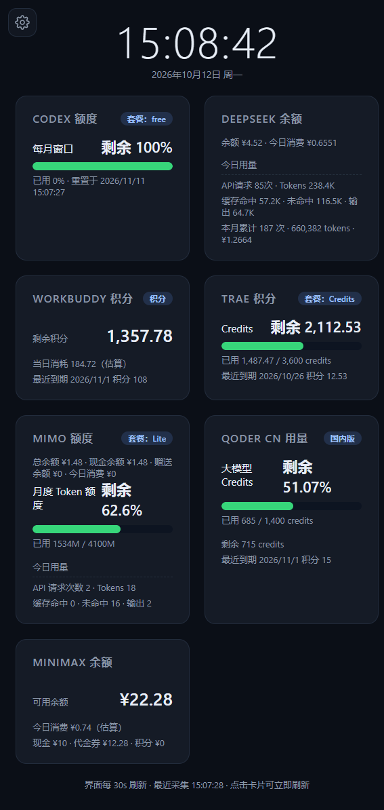

# 华为 M5 平板 AI 用量看板

一个**零第三方依赖**的 Node.js 单页看板服务:聚合 **7 个 AI 产品的额度 / 余额 / 用量**数据,通过局域网网页在华为 M5 平板(HarmonyOS)上以"电子相框"方式常驻展示。

- 服务端:原生 `http` + `fetch`(Node.js ≥ 18),无任何 npm 依赖
- 前端:单文件 `public/index.html`,原生 JS,无构建步骤
- 部署:本机直接 `node server.js`,或 Docker Compose(已提供 `Dockerfile`)
- 默认端口:**8787**

## 效果预览



页面顶部为大字号时钟与日期(适配平板远观),下方按卡片展示 7 个数据源的额度/余额/用量;点击卡片可单独强制刷新,齿轮按钮可调整卡片顺序与显隐。

---

## 目录

- [效果预览](#效果预览)
- [功能特性](#功能特性)
- [数据源一览](#数据源一览)
- [目录结构](#目录结构)
- [快速开始](#快速开始)
- [平板端展示(展示端)](#平板端展示展示端)
- [配置说明](#配置说明)
- [HTTP API](#http-api)
- [运行机制](#运行机制)
- [Docker 部署](#docker-部署)
- [安全说明](#安全说明)
- [已知限制](#已知限制)
- [配套文档](#配套文档)

---

## 功能特性

- **7 源聚合**:一个页面看全 Codex / DeepSeek / WorkBuddy / TRAE / MiMo / Qoder / MiniMax 的额度与用量。
- **自适应刷新**:每个数据源独立计时,连续两次数据无变化则采集间隔按倍数退避(默认 60s → 最长 7200s),数据一变立即回到基准间隔,最大限度节省上游请求额度。
- **模块显隐裁剪**:前端可关闭不需要的卡片,关闭的模块**服务端也停止采集**(状态持久化,重启后仍生效),显隐状态以服务端为准,多设备间不互相覆盖。
- **卡片排序 / 手动刷新**:点击卡片可单独强制刷新该源;卡片顺序可拖动调整(localStorage 持久化)。
- **"当日消耗"估算**:对上游只提供周期粒度数据的源(WorkBuddy、MiniMax),服务端用每日首次读数做基线、按差值近似当日消耗,快照落盘在 `data/`,容器重建不丢失。
- **令牌自动续期(仅 WorkBuddy)**:access_token 过期时自动用 refresh_token 续期一次并原子回写 `config/workbuddy.json`。
- **只读设计**:所有采集均为只读查询,不做任何消费/写操作;密钥仅存服务端 `config/`,不下发前端。

## 数据源一览

| # | 数据源 | 展示内容 | 鉴权方式 | 接口性质 | 凭据文件 |
|---|--------|----------|----------|----------|----------|
| 1 | **Codex**(ChatGPT) | 5 小时 / 周额度用量、重置时间 | OAuth `access_token`(复制自 `~/.codex/auth.json`) | 未公开(ChatGPT WHAM,即 codex CLI 同源端点) | `config/codex.json` |
| 2 | **DeepSeek** | 账户余额 + 今日消费/请求数/tokens | 余额用官方 API Key;用量用平台网页 `userToken` | 余额官方公开;用量为平台内部接口 | `config/deepseek.json` |
| 3 | **WorkBuddy**(腾讯 CodeBuddy 国内版) | 积分包总额/已用/剩余、到期积分(3/7 天窗口)、当日消耗(估算) | Bearer accessToken + X-User-Id,支持 refreshToken 自动续期 | 内部 HTTP 接口(兼容 v2 / summary 两条路径) | `config/workbuddy.json` |
| 4 | **TRAE CN** | 积分额度、周期用量、到期积分 | Cloud-IDE-JWT(登录态令牌,过期后用 `trae-token.js` 重新提取) | IDE 内部接口,官方不开放额度查询 | `config/trae.json` |
| 5 | **Xiaomi MiMo** | Token 套餐用量、按天明细、余额 | 网页登录态 Cookie(仅保留 4 个必需字段) | 平台内部接口 | `config/mimo.json` |
| 6 | **Qoder**(CN / 国际版) | 大模型 Credits 用量 | 网页登录态 Cookie | 网页控制台内部接口(个人账号无官方 OpenAPI) | `config/qoder.json` |
| 7 | **MiniMax** | 按量付费账户余额、当日消费(估算) | 官方 API Key(Bearer) | **官方公开接口**(唯一全公开的源) | `config/minimax.json` |

> 未配置的源不会报错,页面显示"未配置"占位;服务启动日志会逐项提示缺哪个字段。

## 目录结构

```
HUAWEI_M5/
├── README.md                              # 本文档
├── Credentials_Guide.md                   # 各数据源凭据获取详细步骤(必读)
├── Dashboard_Data_Modules.md              # 各模块数据获取与计算口径说明
├── Dashboard_Health_Check_Report.md       # 数据准确性体检报告(实测核对)
├── Huawei_M5_AI_Usage_Dashboard_Research.md  # 前期调研报告(选型与架构)
├── Ubuntu_Node_Deploy_Guide.md            # 部署到 Ubuntu 节点的完整方案
└── dashboard/                             # 看板服务本体
    ├── server.js                          # HTTP 服务:路由、调度、自适应刷新、快照
    ├── collector.js                       # 7 个数据源的采集器(全部只读)
    ├── trae-token.js                      # 一次性工具:从本机 TRAE 客户端提取 Cloud-IDE-JWT
    ├── package.json                       # 无依赖,仅 start 脚本
    ├── Dockerfile                         # node:20-bookworm-slim,TZ=Asia/Shanghai
    ├── docker-compose.yml                 # config/ 只读挂载 + data/ 持久化
    ├── public/
    │   └── index.html                     # 单文件前端(看板页面)
    ├── config/                            # 凭据配置(按产品拆分,*.example.json 为模板)
    │   ├── service.json                   # 服务级:host / port / 刷新参数
    │   ├── codex.json                     # Codex OAuth 凭据(= ~/.codex/auth.json 内容)
    │   ├── deepseek.json                  # deepseekApiKey + deepseekPlatformToken
    │   ├── workbuddy.json                 # accessToken / refreshToken / uid / domain
    │   ├── trae.json                      # cloudIdeJwt / deviceId / machineId
    │   ├── mimo.json                      # 网页 Cookie
    │   ├── qoder.json                     # 网页 Cookie + site(cn/intl)
    │   └── minimax.json                   # apiKey + region(cn/intl)
    └── data/                              # 运行时状态快照(自动生成,勿手工编辑)
        ├── workbuddy-state.json           # WorkBuddy 当日消耗基线
        ├── minimax-state.json             # MiniMax 当日消费累计
        └── visibility-state.json          # 前端隐藏模块集合(服务端持久化)
```

## 快速开始

### 环境要求

- Node.js **≥ 18**(需要内置 `fetch`)
- 无 npm 依赖,不需要 `npm install`

### 本机运行

```bash
cd dashboard

# 1. 按模板填写各产品凭据(详见 Credentials_Guide.md)
cp config/codex.example.json config/codex.json      # 把 ~/.codex/auth.json 内容整体复制进去
# ... 其余 deepseek / workbuddy / trae / mimo / qoder / minimax 同理

# 2. 启动
npm start        # 等价于 node server.js
```

启动后访问 `http://<本机IP>:8787`,平板浏览器打开同一地址即可。

### TRAE 令牌提取(仅 TRAE 用户需要)

TRAE CN 不开放额度 API,需从本机已登录的 TRAE 客户端解密提取 `Cloud-IDE-JWT`:

```bash
node trae-token.js                  # 自动探测 Trae CN / TRAE SOLO CN 目录
node trae-token.js --dir "<目录>"   # 或手动指定客户端数据目录
```

脚本读取客户端 `storage.json` 中的加密登录态(tc/AES-128-CBC)并解密,打印出可直接粘贴到 `config/trae.json` 的 JSON。**仅在令牌过期时运行一次**,看板服务本身不读取本机文件。

## 平板端展示(展示端)

### 角色分工

平板**只负责展示**,不运行采集服务、不保存任何密钥/Cookie:服务端(Windows / Ubuntu 节点)采集并聚合数据,平板通过同一 Wi-Fi 以纯 IP 地址访问 `http://<服务端IP>:8787/` 拉取只读 JSON 渲染。

### 平板上用什么软件

展示端采用 **[WallMode](https://github.com/rvbcrs/WallMode)**(GPL-3.0,开源可审计)——一个 Android 看板/Kiosk 应用,内嵌设备自带的 System WebView 全屏加载看板 URL:

- **全屏 + 屏幕常亮**:`fullscreen=on`、`keepScreenOn=on`,适合挂墙常驻;
- **人来亮屏、人走息屏**:前置摄像头人体检测(画面仅本地分析、不录制不上传),无人时自动**调暗/屏保**(亮度 15%),人靠近或触摸后恢复;**注意是"调暗"而非真正 panel off**(WallMode 不提供真关屏,这是明确接受的功能取舍);
- **开机自启**:`autoStartOnBoot=on`,断电恢复后自动回到看板;
- **局域网控制面板**:端口 8099(明文 HTTP + admin 密码,仅限受信局域网),可远程改配置,无需在平板上操作隐藏手势。

### 实测通过的设备与环境

| 项目 | 实测值 |
|------|--------|
| 设备 | HUAWEI MediaPad M5,型号 `CMR-W09`,屏幕 1600×2560 |
| 系统 | HarmonyOS `2.0.0.230`(Android 9 / SDK 28 基座) |
| WebView | `com.huawei.webview 11.1.2.330`(实测渲染正常) |
| 展示应用 | WallMode(`io.github.rvbcrs.wallmode`),独占前置摄像头做人体检测 |
| 看板地址 | `dashboardUrl` 直连 `http://<服务端IP>:8787/` |

### 哪些平板可以直接用

- **看板网页本身**:任何带**现代浏览器/WebView**(Chromium 80+,即 2020 年后的浏览器;页面用到 `??` 等语法)的设备都能打开——Android / HarmonyOS 平板、iPad、手机、PC 浏览器全屏均可,不绑定华为设备。
- **WallMode 展示方案**:要求 **Android 8.0+(minSdk 26)** 及可用的 System WebView;已在 HarmonyOS 2(Android 9 基座)上实测通过。更新的 HarmonyOS / Android 平板理论上兼容,但未逐一实测。
- 不想装 WallMode 的退化方案:任意浏览器打开地址后手动全屏,放弃自动调暗/唤醒与开机自启。

### 平板端注意事项(HarmonyOS 实测经验)

- **必须用纯 IP 地址**:HarmonyOS 2 自带 WebView 无法解析 mDNS 的 `.local` 域名(`ERR_NAME_NOT_RESOLVED`),不要配置 `http://xxx.local:8787/`。
- **`adb screencap` 被禁用**(返回 0 字节),远程查看界面需改用 `uiautomator dump` 拉取 XML 层级。
- WallMode 的隐藏设置手势**只响应真实触摸**,ADB 模拟点击无效;远程配置走 8099 控制面板。

## 配置说明

配置按产品拆分为独立 JSON 文件,放在 `dashboard/config/`,每个文件都有对应 `.example.json` 模板。

### service.json(服务级)

```jsonc
{
  "host": "0.0.0.0",       // 监听地址
  "port": 8787,            // 监听端口
  "refresh": {
    "baseSeconds": 60,     // 自适应刷新基准间隔
    "maxSeconds": 7200,    // 退避上限
    "factor": 2            // 连续两次数据无变化则间隔翻倍
  }
}
```

### 各产品凭据(摘要)

| 文件 | 关键字段 | 说明 |
|------|----------|------|
| `codex.json` | `tokens.access_token` | 直接复制 `~/.codex/auth.json` 全部内容;服务端仅本地解析 JWT 的 exp 提示过期,不验签、不外发、不续期 |
| `deepseek.json` | `deepseekApiKey` / `deepseekPlatformToken` | 前者查官方余额 API;后者为平台网页登录态(浏览器 `JSON.parse(localStorage.userToken).value`),查今日用量 |
| `workbuddy.json` | `accessToken` / `refreshToken` / `uid` / `domain` / `refreshUrl` | 配置 refreshToken + refreshUrl 后支持过期自动续期并回写 |
| `trae.json` | `cloudIdeJwt` / `deviceId` / `machineId` | JWT 用 `trae-token.js` 提取;设备头可选,配置了就一直带上 |
| `mimo.json` | `cookie` | 整行 Cookie 粘贴即可,服务端自动裁剪到 4 个必需字段 |
| `qoder.json` | `cookie` / `site` | site 取 `cn`(qoder.com.cn,默认)或 `intl`(qoder.com);Cookie 支持带 `Cookie:` 前缀或多行请求头粘贴 |
| `minimax.json` | `apiKey` / `region` / `baseUrl` | region 取 `cn`(api.minimaxi.com,默认)或 `intl`(api.minimax.io);baseUrl 可覆盖接口根地址 |

> 每个凭据的**详细获取步骤**(从哪个网页/文件、怎么复制、何时过期)见 [`Credentials_Guide.md`](Credentials_Guide.md)。

## HTTP API

| 方法 | 路径 | 说明 |
|------|------|------|
| GET | `/` | 看板页面(静态资源一律 `Cache-Control: no-store`,避免平板 WebView 强缓存旧页面) |
| GET | `/api/usage` | 返回聚合 JSON:各源最新缓存片段 + 各源自己的 `xxxUpdatedAt` + `hiddenSources`。首次请求会并行补齐未采集过的源 |
| GET | `/api/usage?source=<name>` | 强制立即采集该源一次(手动刷新),并把它的自适应间隔重置回基准 |
| GET | `/api/usage?refresh=1` | 强制刷新全部源(调试入口),已隐藏的模块跳过 |
| POST | `/api/visibility` | 请求体 `{ "hidden": ["源名", ...] }`,更新隐藏模块集合;被隐藏的源立即停止后台采集,重新显示的源约 2 秒内补采一次。响应返回服务端当前生效的集合 |

源名合法值:`codex`、`deepseek`、`workbuddy`、`trae`、`mimo`、`qoder`、`minimax`。

响应示例(节选):

```jsonc
{
  "updatedAt": "2026-10-12T03:00:00.000Z",
  "hiddenSources": ["mimo"],
  "codex": { "ok": true, /* 5小时/周额度、重置时间等 */ },
  "codexUpdatedAt": "2026-10-12T02:59:40.000Z",
  "deepseek": { "ok": true, /* 余额 */ },
  "deepseekUsage": { "ok": true, /* 今日消费/请求数/tokens */ },
  "workbuddy": { "ok": true, "totalUsed": 123.45, "todayUsed": 12.3, "todayUsedEstimated": true },
  "minimax": { "ok": true, "balance": { "available": 98.0 }, "todaySpent": 1.25, "todaySpentEstimated": true }
}
```

> DeepSeek 卡片跨两个上游接口(余额 + 今日用量),一次采集同时产出 `deepseek` 与 `deepseekUsage` 两个字段。

## 运行机制

### 自适应刷新(server.js)

- 每个源**独立计时、独立退避**:按基准间隔采集;用"递归按 key 排序的稳定序列化"做数据指纹,连续两次指纹相同则间隔 ×factor,直到上限;一旦变化立即回到基准。
- 首次启动各源**错峰 2 秒**依次开跑,之后每次间隔附加 **±10% 抖动**,避免多源长期同步、同时打上游。
- 同一源在途采集复用同一 Promise,不会并发重入。

### 当日消耗估算(data/ 快照)

- **WorkBuddy**:上游只有周期粒度用量、无日期粒度。以"当日首次读数"为基线,对 Σ周期已用 做差近似当日消耗(`todayUsedEstimated: true`)。跨天、换包/到期导致读数回退时自动重置基线,避免负值。
- **MiniMax**:官方只有余额接口、无消费明细。按"同一自然日内可用余额的下滑量"累加近似当日消费;余额上升视为充值,不计入。
- 快照均为**先写临时文件再 rename** 的原子写入。

### 隐藏模块采集裁剪

前端每次打开页面及切换卡片显隐时,把当前隐藏集合 POST 到 `/api/visibility`;服务端持久化到 `data/visibility-state.json`,重启后依然生效。隐藏的源不再排下一次自动采集(手动强制刷新仍允许,便于调试)。

## Docker 部署

```bash
cd dashboard
docker compose up -d --build
```

`docker-compose.yml` 要点:

- 镜像基于 `node:20-bookworm-slim`,安装 tzdata 并设 `TZ=Asia/Shanghai`,保证"今日用量"按本地日期统计;
- `./config` **只读**挂载(凭据不打进镜像);
- `./data` 读写挂载(当日消耗基线等快照持久化,容器重建不丢失);
- 端口默认映射 `8787:8787`(所有网卡);如需限定来源可改为 `"192.168.x.x:8787:8787"`。

部署到远程 Ubuntu 节点(含 Docker Hub 不可达的镜像源处理、Codex 凭据迁移矩阵、scp 上传步骤)见 [`Ubuntu_Node_Deploy_Guide.md`](Ubuntu_Node_Deploy_Guide.md)。

## 安全说明

- **密钥不出服务端**:所有凭据只存于 `config/`,API 响应与前端页面不包含任何令牌/Cookie。
- **只读采集**:对上游全部是查询类请求,无消费、无写操作。
- **Cookie 最小化**:MiMo Cookie 自动裁剪到 4 个鉴权必需字段,其余丢弃,避免携带无关隐私。
- **静态目录防穿越**:`serveStatic` 校验解析后路径必须精确等于或以 `public/` + 分隔符开头,防止 `public-data/` 之类同级目录被前缀绕过。
- **请求体限制**:`/api/visibility` 请求体上限 16KB,超限直接断开。
- **TRAE 刻意不做自动续期**:TRAE 的 ExchangeToken 会轮换整个令牌族、把其它客户端登录态一起踢掉,故看板只被动使用令牌,过期后手动用 `trae-token.js` 重取。
- `config/` 已列入 `.gitignore` / `.dockerignore`,注意不要将真实凭据提交到版本库。

## 已知限制

- 除 DeepSeek 余额与 MiniMax 外,其余数据源均为**非公开内部接口**,可能随平台改版随时失效;采集器已做容错(包裹层 `code/msg` 显式判错,避免过期令牌被误判为"零用量"),失效时需按报错更新。
- 网页登录态类凭据(MiMo / Qoder / DeepSeek 平台 Token / TRAE JWT)都会过期,过期后需手动重新获取(见 Credentials_Guide.md 各节"生效与过期")。
- MiniMax 采集器目前只覆盖**按量付费**账号(`/account/query_balance`);Token Plan 订阅 Key(`sk-` 非 `sk-api-` 前缀)的 `/v1/token_plan/remains` 暂不支持。
- WorkBuddy / MiniMax 的"当日消耗"为**估算值**(响应带 `xxxEstimated: true`),依赖服务当天持续运行以维持基线;服务停摆跨天会重置基线。
- 数据准确性实测核对结论见 [`Dashboard_Health_Check_Report.md`](Dashboard_Health_Check_Report.md)。

## 配套文档

| 文档 | 内容 |
|------|------|
| [Credentials_Guide.md](Credentials_Guide.md) | 7 个数据源凭据的逐项获取步骤、写入配置、生效与过期说明 |
| [Dashboard_Data_Modules.md](Dashboard_Data_Modules.md) | 各模块的接口、关键字段、计算口径与前端渲染逻辑 |
| [Dashboard_Health_Check_Report.md](Dashboard_Health_Check_Report.md) | 实测数据核对与问题清单(含两轮复查结论) |
| [Huawei_M5_AI_Usage_Dashboard_Research.md](Huawei_M5_AI_Usage_Dashboard_Research.md) | 前期调研:候选项目对比、HarmonyOS 兼容性、目标架构 |
| [Ubuntu_Node_Deploy_Guide.md](Ubuntu_Node_Deploy_Guide.md) | 部署到 Ubuntu 节点的完整方案(镜像源、配置迁移、compose) |
